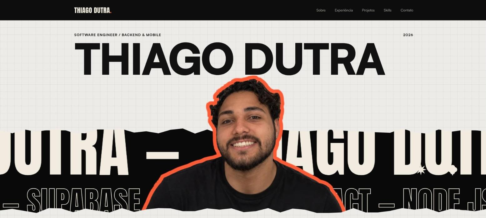

<!-- markdownlint-disable MD033 -->
<div align="center">

# Portfólio — Thiago Dutra

**Backend & Mobile Developer: Flutter, React e Node.js.**

[](https://dutrathiagodev.com.br)




</div>

## Sobre

Portfólio pessoal em tema escuro e minimalista, com as páginas Sobre, Experiência, Projetos, Skills e Contato. Começou como um site estático em HTML, CSS e JavaScript e foi migrado para Next.js e redesenhado em estilo cartaz: papel quadriculado, bordas rasgadas, faixa preta com a frase passando e retrato recortado com contorno coral. O conteúdo cobre experiência na Fteam, na Lifeados Academy e no EAD da FAP, projetos em produção e em desenvolvimento, a startup RiseMov, mentorias e formação.

## Links

| | |
|---|---|
| Site publicado | https://dutrathiagodev.com.br (atualizado a cada mudança na `main`) |
| Repositório | https://github.com/dutrathiagodev/portifolio |
| LinkedIn | [dutrathiagodev](https://www.linkedin.com/in/dutrathiagodev/) |
| GitHub | [dutrathiagodev](https://github.com/dutrathiagodev) |

## O que tem no site

- **Home** com hero em estilo cartaz (retrato com parallax), seção Olá (bio, skills principais, formação e experiência), seção Entrega com o pipeline animado (Build, Teste, Deploy e Produção, com um pulso em loop) e projetos em destaque
- **Sobre**, com o que eu faço, a startup RiseMov (estudos com IA e Mastery Learning, de Benjamin Bloom), as mentorias (Lifeados Academy e Acelera Dev) e a formação, incluindo o CS50x de Harvard
- **Experiência**, em linha do tempo: EAD da FAP, Fteam e Lifeados Academy
- **Projetos**, em lista com status (em produção ou em desenvolvimento), camadas (Mobile, Web, API e Banco) e a equipe RiseMov; inclui a plataforma white label MRNT e os apps Pass7 e MRNT Teen
- **Skills**, agrupadas por área, incluindo UX/UI Design e IA no desenvolvimento (Claude Code e Codex)
- **Contato**, com o e-mail em destaque e botão de copiar, canais (WhatsApp, LinkedIn, GitHub e Instagram) e um formulário no estilo "mad-lib" que monta um e-mail pronto (`mailto:`), sem backend
- **Logo** em wordmark `THIAGO DUTRA.` em Anton, com o ponto coral, e favicon com o monograma TD
- **SEO**: título e descrição por página, Open Graph e Twitter Card, imagem de compartilhamento com o hero (retrato e título em estilo cartaz), `sitemap.xml`, `robots.txt` e dados estruturados (JSON-LD)
- Todas as páginas seguem o mesmo estilo cartaz: título gigante no papel quadriculado, borda rasgada e faixa preta com a frase passando
- Animações de entrada e ao rolar, parallax no hero (mouse e rolagem) e suporte a `prefers-reduced-motion`
- Menu com destaque automático da página atual e barra de rolagem personalizada
- Layout responsivo (desktop, tablet e celular)

## Projetos em destaque

| Projeto | Descrição | Tecnologias |
|---|---|---|
| [Face a Face](https://github.com/dutrathiagodev/landing-page-face-a-face) | Guia cívico do 2º turno de 2026, com comparativo equilibrado e fontes | Next.js, Tailwind, Figma |
| [To-Do List Detetive](https://github.com/dutrathiagodev/to-do-list-detetive) | Lista de tarefas com tema de investigação | Next.js, TypeScript, localStorage |
| [OneTick](https://github.com/dutrathiagodev/onetick) | Um foco essencial por dia, com histórico e sequência | Flutter, Firebase, Cubit |
| [FAP Books](https://github.com/dutrathiagodev/fap-books) | Gestão e empréstimo de livros da biblioteca da FAP (equipe de 6, Tech Lead, Dev e QA) | Next.js, Supabase, PostgreSQL, Git Flow |

Outros projetos: MRNT (plataforma white label) e os apps Pass7 e MRNT Teen, FutiFC, Together Movement (QA e suporte), Weloz, Elos e o Big-Z (em equipe, na [RiseMov](https://github.com/RiseMov)).

## Tecnologias

- [Next.js 16](https://nextjs.org) (App Router) e [React 19](https://react.dev)
- [TypeScript](https://www.typescriptlang.org)
- [Tailwind CSS 4](https://tailwindcss.com)
- Fontes [Satoshi](https://www.fontshare.com/fonts/satoshi) (Fontshare), [Anton](https://fonts.google.com/specimen/Anton) e [JetBrains Mono](https://www.jetbrains.com/lp/mono/)
- ESLint
- [Vercel](https://vercel.com) para o deploy

## Como rodar

Pré-requisito: Node.js 20 ou superior.

```bash
npm install
npm run dev     # desenvolvimento em http://localhost:3000
npm run lint    # lint
npm run build   # build de produção
npm run start   # serve o build
```

## Estrutura

```text
src/
  app/                  layout, páginas (uma pasta por rota), fontes, estilos globais, ícone, sitemap, robots e imagem de compartilhamento
  components/
    layout/             header, footer e dados estruturados (JSON-LD)
    sections/<secao>/   uma pasta por seção do site
    ui/                 componentes visuais reutilizáveis
  content/              textos e dados de cada página
  lib/                  utilitários
  types/                tipos compartilhados
public/
  images/               retrato usado no hero
  icons/                ícones das redes e das tecnologias
docs/
  architecture/         regras de arquitetura do projeto
  images/               imagens usadas na documentação (print da tela principal)
```

Cada página em `src/app` só compõe uma seção. Os textos ficam em `src/content` e os componentes só cuidam da apresentação. As regras completas estão em [`docs/architecture`](docs/architecture).

## Publicação

O site é publicado na Vercel a cada push na `main`, sem arquivo de configuração: a Vercel detecta o Next.js e roda `npm run build`. O endereço usado no SEO fica em `src/content/site.ts` (ou na variável `NEXT_PUBLIC_SITE_URL`); ao trocar para um domínio próprio, é só mudar ali.

## Contato

- 📧 [thiagodutrasap@gmail.com](mailto:thiagodutrasap@gmail.com)
- 💼 [LinkedIn](https://www.linkedin.com/in/dutrathiagodev/)
- 🐙 [GitHub](https://github.com/dutrathiagodev)
- 📸 [Instagram](https://www.instagram.com/dutrathiago.dev/)
